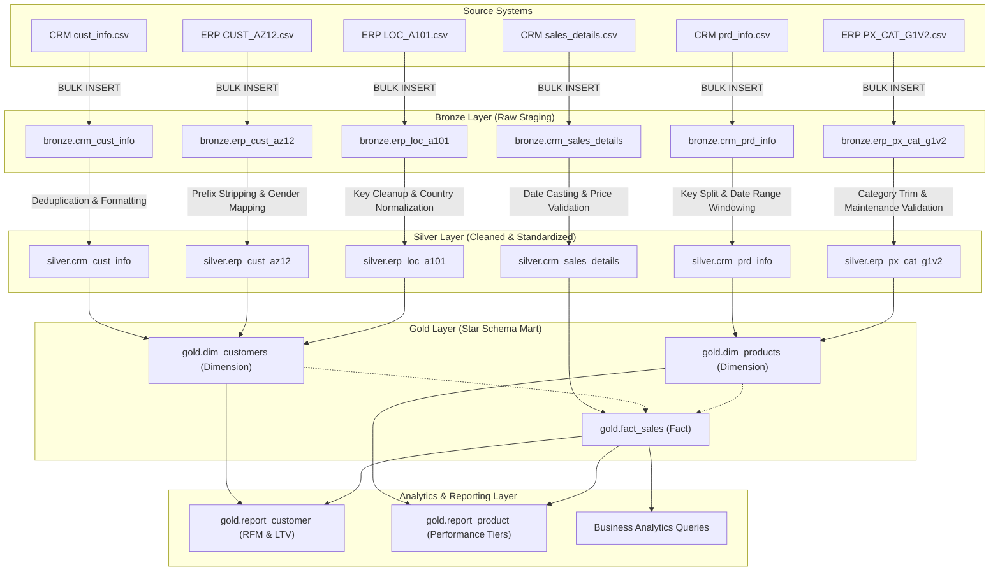
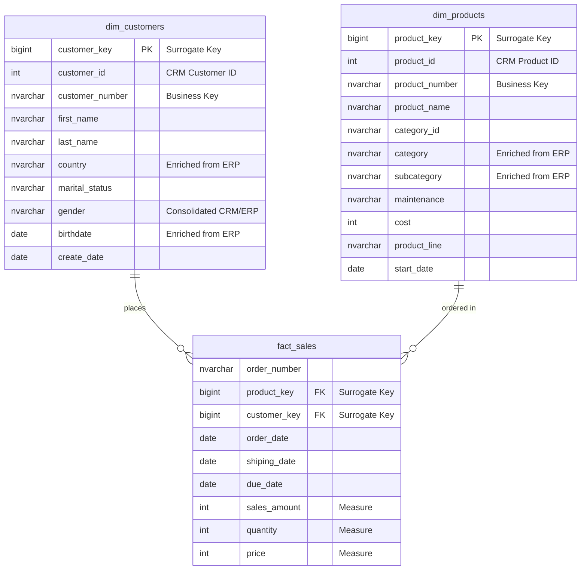

# Enterprise Data Warehouse & Analytics with SQL Server (Medallion Architecture)

[](https://www.microsoft.com/sql-server)
[](https://docs.microsoft.com/sql/t-sql/)
[-green)](#architecture-overview)
[](#3-gold-layer-analytical-star-schema)
[](#business-intelligence--analytical-reporting-layer)

An end-to-end Data Warehousing and Business Intelligence solution built on Microsoft SQL Server. This project models and delivers an enterprise analytics layer by integrating disparate raw datasets from CRM and ERP systems, applying rigorous ETL transformations, implementing data quality frameworks, constructing an analytical Kimball Star Schema, and delivering advanced business reporting views and analytics queries.

---

## Table of Contents

- [Project Overview](#project-overview)
- [Architecture Overview](#architecture-overview)
- [Data Pipeline Flow](#data-pipeline-flow)
- [Source Datasets](#source-datasets)
- [Medallion Layers Breakdown](#medallion-layers-breakdown)
  - [Bronze Layer (Raw Ingestion)](#1-bronze-layer-raw-ingestion)
  - [Silver Layer (Cleansing & Transformation)](#2-silver-layer-cleansing--transformation)
  - [Gold Layer (Analytical Star Schema)](#3-gold-layer-analytical-star-schema)
- [Business Intelligence & Analytical Reporting Layer](#business-intelligence--analytical-reporting-layer)
  - [Customer & Product Reporting Views](#1-enterprise-reporting-views)
  - [Advanced Analytical Modules](#2-advanced-analytical-modules)
- [Data Quality & Testing Framework](#data-quality--testing-framework)
- [Repository Structure](#repository-structure)
- [Setup & Execution Guide](#setup--execution-guide)
- [Key SQL & Engineering Highlights](#key-sql--engineering-highlights)

---

## Project Overview

In real-world enterprise environments, business data is often fragmented across multiple systems (e.g., customer relationship systems, ERP financial systems), formatted inconsistently, and riddled with duplicates, malformed dates, and missing records.

This project delivers a centralized **Data Warehouse** (`DataWarehouse`) that:
1. **Ingests** unstructured and semi-structured CRM and ERP CSV exports into an ingestion landing zone (**Bronze**).
2. **Standardizes, deduplicates, cleanses, and enriches** the data using T-SQL stored procedures (**Silver**).
3. **Models** data into a Kimball Star Schema with dimension views and a fact view optimized for reporting (**Gold**).
4. **Delivers business intelligence** through curated reporting views (`gold.report_customer`, `gold.report_product`) and advanced analytical scripts (RFM customer segmentation, running totals, YoY growth, and category share).
5. **Verifies** data integrity at every step with an extensive suite of automated data quality tests.

---

## Architecture Overview

The project adheres to the **Medallion Architecture**, dividing the data estate into structured layers of refinement:

```
[ CRM & ERP Source CSVs ]
            │
            ▼ (BULK INSERT via bronze.load_bronze)
┌────────────────────────────────────────────────────────┐
│                      BRONZE LAYER                      │
│        Raw, unaltered copy of ingested sources         │
└────────────────────────────────────────────────────────┘
            │
            ▼ (ETL Transforms via silver.load_silver)
┌────────────────────────────────────────────────────────┐
│                      SILVER LAYER                      │
│     Cleaned, conformed, standardized & validated       │
└────────────────────────────────────────────────────────┘
            │
            ▼ (Dimensional Modeling via Views)
┌────────────────────────────────────────────────────────┐
│                       GOLD LAYER                       │
│           Kimball Star Schema (Facts & Dims)           │
└────────────────────────────────────────────────────────┘
            │
            ▼ (Analytics & KPI Aggregations)
┌────────────────────────────────────────────────────────┐
│              ANALYTICS & REPORTING LAYER               │
│   Reporting Views (RFM, Tiers) & Business Queries      │
└────────────────────────────────────────────────────────┘
```

---

## Data Pipeline Flow



---

## Source Datasets

The raw data is stored in the `datasets/` directory and partitioned across two business sources:

### 1. Customer Relationship Management (CRM)
- `datasets/source_crm/cust_info.csv`: Customer identification, full name, marital status, gender, and profile creation date.
- `datasets/source_crm/prd_info.csv`: Product catalog containing product keys, names, costs, product lines, and active validity date windows.
- `datasets/source_crm/sales_details.csv`: Historical sales transactions, tracking orders, order dates, ship dates, due dates, quantities, and price points.

### 2. Enterprise Resource Planning (ERP)
- `datasets/source_erp/CUST_AZ12.csv`: Demographic records providing customer birth dates and additional gender values with legacy `NAS` prefixes.
- `datasets/source_erp/LOC_A101.csv`: Geographical location mapping linking customer IDs (with hyphen formatting) to country codes.
- `datasets/source_erp/PX_CAT_G1V2.csv`: Product classification details mapping category keys to high-level categories, subcategories, and maintenance requirements.

---

## Medallion Layers Breakdown

### 1. Bronze Layer (Raw Ingestion)
- **Script**: `scripts/bronze/ddl_bronze.sql`
- **Stored Procedure**: `scripts/bronze/proc_load_bronze.sql`
- **Purpose**: Provides a low-latency raw landing zone without transformations, preserving original source fidelity.
- **Features**:
  - Drops and recreates 6 target tables inside the `bronze` schema.
  - Implements `TRUNCATE TABLE` followed by `BULK INSERT` for fast data ingestion.
  - Wraps execution in `BEGIN TRY...BEGIN CATCH` blocks.
  - Tracks and outputs detailed execution runtimes per table and across the entire batch.

### 2. Silver Layer (Cleansing & Transformation)
- **Script**: `scripts/silver/ddl_silver.sql`
- **Stored Procedure**: `scripts/silver/proc_load_silver.sql`
- **Purpose**: Cleanses, deduplicates, validates, and harmonizes Bronze data into structured analytical tables with an audit timestamp (`dwh_create_date`).
- **Core Transformations**:
  - **Deduplication**: Resolves duplicate customer IDs in `crm_cust_info` using `ROW_NUMBER() OVER(PARTITION BY cst_id ORDER BY cst_create_date DESC)` to preserve only the most recent entry.
  - **Text Trimming & Standardization**: Strips unwanted leading and trailing whitespace; normalizes marital statuses (`M` -> `Married`, `S` -> `Single`) and gender values (`M` / `MALE` -> `Male`, `F` / `FEMALE` -> `Female`).
  - **Key Normalization**: Strips legacy system artifacts (e.g., removes `NAS` prefix from ERP `cid`, removes hyphens from location keys) to allow seamless cross-system joins.
  - **Derived Attribute Extraction**: Splits composite product keys into clean sub-attributes (`cat_id` and `prd_key`).
  - **SCD Historical Interval Handling**: Dynamically calculates product expiration dates (`prd_end_dt`) using the window function `LEAD(prd_start_dt) OVER (PARTITION BY prd_key ORDER BY prd_start_dt) - 1`.
  - **Data Type Casting & Cleansing**: Converts integer dates (e.g. `20230101`) to proper `DATE` types while filtering out zero or malformed lengths.
  - **Calculation Integrity**: Corrects sales values if missing or negative using `sls_quantity * ABS(sls_price)`, and backfills unit prices using `sls_sales / NULLIF(sls_quantity, 0)`.

### 3. Gold Layer (Analytical Star Schema)
- **Script**: `scripts/gold/ddl_gold.sql`
- **Purpose**: Surfaces clean, modeled business views optimized for reporting tools (Power BI, Tableau, Excel) via a dimensional Star Schema.



- **`gold.dim_customers`**: Combines CRM customer data with ERP demographics (`erp_cust_az12`) and locations (`erp_loc_a101`), assigning a surrogate `customer_key` via `ROW_NUMBER()`.
- **`gold.dim_products`**: Blends CRM product details with ERP catalog metadata (`erp_px_cat_g1v2`), filtering for currently active items (`prd_end_dt IS NULL`) and assigning a surrogate `product_key`.
- **`gold.fact_sales`**: Granular transaction fact view that joins `silver.crm_sales_details` to the customer and product dimensions via surrogate keys.

---

## Business Intelligence & Analytical Reporting Layer

Located in `scripts/analysis/`, this layer turns the modeled Gold data warehouse into actionable business intelligence through reusable enterprise reporting views and deep-dive analytical queries.

### 1. Enterprise Reporting Views

#### Customer 360 & RFM Report (`scripts/analysis/report_customers.sql`)
Creates the consolidated reporting view **`gold.report_customer`**, combining customer demographics with behavioral KPIs:
- **Demographic Segmentation**: Groups customers into cohorts (`Under 20`, `20-29`, `30-39`, `40-49`, `50 and above`).
- **Behavioral Segmentation**: Classifies customers into strategic tiers:
  - **VIP**: $\ge 12$ months customer lifespan and spending $> \$5,000$.
  - **Regular**: $\ge 12$ months customer lifespan and spending $\le \$5,000$.
  - **New**: Lifespan $< 12$ months.
- **Customer Lifetime Metrics**: Aggregates total orders, total sales revenue, total quantity purchased, product diversity count, and customer lifespan (in months).
- **Executive KPIs**:
  - **Recency**: Months elapsed since last purchase (`DATEDIFF(MONTH, last_order_date, GETDATE())`).
  - **Average Order Value (AOV)**: Revenue per completed order (`total_sales / total_orders`).
  - **Average Monthly Spend**: Revenue generation rate across customer tenure (`total_sales / lifespan`).

#### Product Performance & Revenue Report (`scripts/analysis/report_product.sql`)
Creates the reporting view **`gold.report_product`**, tracking product profitability and market velocity:
- **Product Revenue Segmentation**:
  - **High-Performer**: Total sales $> \$50,000$.
  - **Mid-Range**: Total sales between $\$10,000$ and $\$50,000$.
  - **Low-Performer**: Total sales $< \$10,000$.
- **Commercial Performance KPIs**:
  - Unique customer reach (`COUNT(DISTINCT customer_key)`).
  - Average Realized Selling Price (`avg_selling_price`).
  - Product Lifespan in months and last sale recency.
  - **Average Order Revenue (AOR)** and **Average Monthly Revenue**.

---

### 2. Advanced Analytical Modules

| Analysis Script | Business Purpose | Key T-SQL Techniques |
| :--- | :--- | :--- |
| **`change_over_time_analysis.sql`** | Evaluates multi-year sales trends, seasonality, monthly customer acquisition, and order volume patterns. | `DATETRUNC(MONTH, order_date)`, `YEAR()`, `MONTH()`, `FORMAT(order_date, 'yyyy-MMM')` |
| **`cumulative_analysis.sql`** | Tracks running total revenue and moving average prices over time to analyze growth trajectories. | Window Aggregations: `SUM(total_sales) OVER (ORDER BY order_date)`, moving averages |
| **`data_segmentation.sql`** | Categorizes products into cost tiers (`< $100`, `$100-$500`, `$500-$1000`, `> $1000`) and segments customer spending patterns. | CTEs (`WITH product_segments AS ...`), multi-condition `CASE` logic |
| **`part_to_whole_analysis.sql`** | Computes category share-of-wallet and proportion of total revenue to identify business-driving categories. | Window Proportions: `SUM(total_sales) OVER ()`, `ROUND((CAST(total_sales AS FLOAT) / SUM(total_sales) OVER()) * 100, 2)` |
| **`performance_analysis.sql`** | Measures product performance against historical product averages and previous year's revenue (YoY analysis). | `AVG() OVER (PARTITION BY product_name)`, `LAG(current_sales) OVER (...)`, YoY variance tracking |

---

## Data Quality & Testing Framework

Comprehensive SQL test scripts ensure data accuracy, domain compliance, and referential integrity across the pipeline:

### Silver Layer Checks (`tests/quality_checks_silver.sql`)
- **Primary Key Uniqueness & Nullability**: Validates that all primary identifiers have zero duplicates and no nulls.
- **Whitespace Checks**: Identifies lingering leading/trailing whitespace across names, countries, and categories.
- **Domain Consistency**: Asserts standard categorical domains for marital status, gender, product lines, and countries.
- **Date & Chronology Sanity**:
  - Ensures customer birth dates and account creation dates are not in the future.
  - Ensures product start dates precede end dates.
  - Enforces order fulfillment chronology: `sls_order_dt <= sls_ship_dt <= sls_due_dt`.
- **Financial & Calculation Checks**: Verifies `sls_sales > 0`, `sls_quantity > 0`, `sls_price > 0`, and checks that `sls_sales = sls_quantity * ABS(sls_price)`.
- **Reconciliation Audit**: Computes unionized row counts across Bronze and Silver to evaluate ingestion and deduplication loss.

### Gold Layer Checks (`tests/quality_checks_gold.sql`)
- **Dimension Key Uniqueness**: Confirms surrogate keys `customer_key` and `product_key` are strictly unique.
- **Referential Integrity**: Detects orphaned sales transactions by testing for unmatched foreign keys (`WHERE p.product_key IS NULL OR c.customer_key IS NULL`).

---

## Repository Structure

```plaintext
Data-Analysis-Using-SQL/
├── README.md                               # Comprehensive project documentation
├── datasets/                               # Source raw data files
│   ├── source_crm/                         # CRM source exports
│   │   ├── cust_info.csv
│   │   ├── prd_info.csv
│   │   └── sales_details.csv
│   └── source_erp/                         # ERP source exports
│       ├── CUST_AZ12.csv
│       ├── LOC_A101.csv
│       └── PX_CAT_G1V2.csv
├── scripts/                                # DDL, ETL, and Analytical scripts
│   ├── init_database.sql                   # Database and schema initialization script
│   ├── bronze/
│   │   ├── ddl_bronze.sql                  # Table definitions for Bronze layer
│   │   └── proc_load_bronze.sql            # Stored procedure for Bronze BULK INSERT
│   ├── silver/
│   │   ├── ddl_silver.sql                  # Table definitions for Silver layer
│   │   └── proc_load_silver.sql            # Stored procedure for Silver ETL cleaning
│   ├── gold/
│   │   └── ddl_gold.sql                    # Dimension and fact view definitions
│   └── analysis/                           # Advanced Business Analytics & Reporting
│       ├── report_customers.sql            # View: gold.report_customer (RFM & LTV KPIs)
│       ├── report_product.sql              # View: gold.report_product (Performance Tiers)
│       ├── change_over_time_analysis.sql   # Time-series trends (YoY, MoM, DATETRUNC)
│       ├── cumulative_analysis.sql         # Running totals and moving averages
│       ├── data_segmentation.sql           # Customer spend & product cost segmentation
│       ├── part_to_whole_analysis.sql      # Category share-of-wallet (% of total)
│       └── performance_analysis.sql        # Historical performance benchmarking & LAG()
└── tests/                                  # Data quality and testing suites
    ├── quality_checks_silver.sql           # Quality assertions for Bronze & Silver layers
    └── quality_checks_gold.sql             # Quality checks for Gold Star Schema & RI
```

---

## Setup & Execution Guide

### Prerequisites
- **Database Engine**: Microsoft SQL Server (2016 or newer recommended).
- **Client Tool**: SQL Server Management Studio (SSMS), Azure Data Studio, or VS Code (mssql extension).
- **Permissions**: Permissions to create databases, schemas, views, stored procedures, and execute `BULK INSERT`.

### Execution Order

#### Step 1: Initialize Database & Schemas
Open and execute `scripts/init_database.sql` to create the `DataWarehouse` database and the three schemas (`bronze`, `silver`, `gold`):
```sql
USE master;
GO
-- Executes scripts/init_database.sql
```

#### Step 2: Build & Load Bronze Layer
1. Execute `scripts/bronze/ddl_bronze.sql` to create the raw ingestion tables.
2. In `scripts/bronze/proc_load_bronze.sql`, ensure file paths point to your local clone's `datasets/` folder.
3. Compile the stored procedure and load raw data:
```sql
USE DataWarehouse;
GO
EXEC bronze.load_bronze;
```

#### Step 3: Build & Load Silver Layer
1. Execute `scripts/silver/ddl_silver.sql` to create cleansed tables.
2. Compile and execute `scripts/silver/proc_load_silver.sql`:
```sql
USE DataWarehouse;
GO
EXEC silver.load_silver;
```

#### Step 4: Create Gold Star Schema Views
Execute `scripts/gold/ddl_gold.sql` to create the Star Schema views (`gold.dim_customers`, `gold.dim_products`, and `gold.fact_sales`).

#### Step 5: Build Analytical Reporting Views
Execute the reporting views in `scripts/analysis/`:
- Run `scripts/analysis/report_customers.sql` to create `gold.report_customer`.
- Run `scripts/analysis/report_product.sql` to create `gold.report_product`.

#### Step 6: Run Business Analytics Queries
Execute analytical scripts in `scripts/analysis/` for executive reporting:
- `change_over_time_analysis.sql` for longitudinal sales & customer growth trends.
- `cumulative_analysis.sql` for running revenue totals and moving averages.
- `part_to_whole_analysis.sql` for category market share analysis.
- `performance_analysis.sql` for YoY product growth and benchmark variances.
- `data_segmentation.sql` for VIP/Regular/New customer distribution.

#### Step 7: Run Data Quality Checks
Execute the automated test suites in `tests/`:
- Run `tests/quality_checks_silver.sql` to verify deduplication, transformation, and reconciliation.
- Run `tests/quality_checks_gold.sql` to confirm surrogate key uniqueness and zero orphaned records.

---

## Key SQL & Engineering Highlights

- **Common Table Expressions (CTEs)**: Structured multi-step analytical pipelines separating base joins, metric aggregations, and business classification layers.
- **Window Analytical Functions**:
  - `ROW_NUMBER() OVER (...)` for latest-record deduplication and surrogate key generation.
  - `LEAD()` for calculating dynamic expiration dates for slowly changing dimensions (SCD).
  - `LAG()` for evaluating Year-over-Year (YoY) revenue variances.
  - `SUM(...) OVER (ORDER BY ...)` for running cumulative totals.
  - `SUM(...) OVER ()` and `AVG(...) OVER (PARTITION BY ...)` for part-to-whole share calculations and product benchmark comparisons.
- **Date Truncation & Formatting**: Leveraged `DATETRUNC()`, `DATEDIFF()`, and `FORMAT()` to aggregate temporal data cleanly across year, month, and formatted calendar periods.
- **Defensive Data Handling**: Applied `NULLIF()`, `COALESCE()`, and `CASE` statements to guard against divide-by-zero errors, negative prices, and cross-system null values.
- **Observability & Error Handling**: Structured stored procedures inside `BEGIN TRY ... BEGIN CATCH` blocks capturing error telemetry and runtime duration logging.
